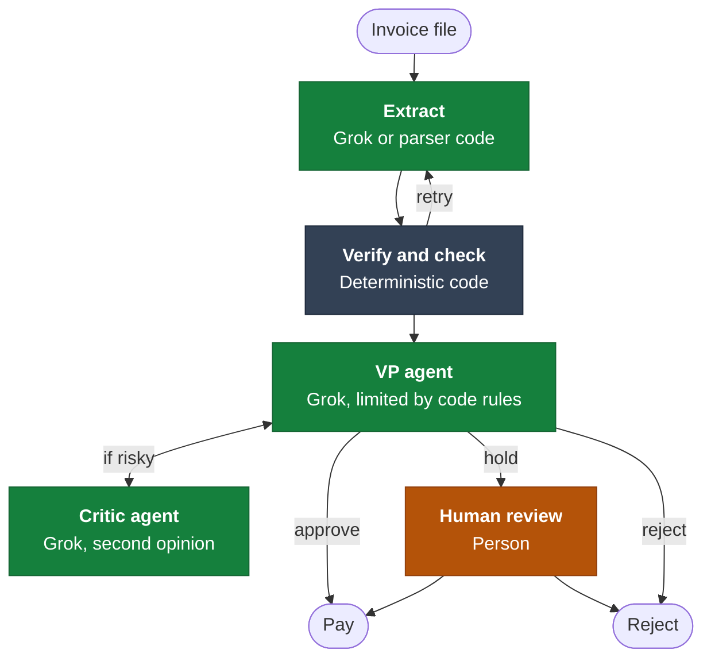

# AutoVoice

AutoVoice is a working multi-agent prototype that takes an invoice from a messy file to one of three results: paid, rejected or held for a person. Every step is recorded.

It was built for the Galatiq invoice processing case. Acme Corp is fictional, the sample invoices are test data, and no real money moves: payments go through a mock function.

## The problem

Acme Corp loses an estimated $2M a year on manual invoice processing. Invoices arrive in messy formats, staff enter the data by hand, and approvals get lost in email chains. The result is a 30% error rate and 5-day delays.

## Key solutions

- **Reads messy invoices automatically.** Grok reads TXT and PDF files, and parser code reads JSON, CSV and XML. Errors go back for a retry.
- **Catches errors before payment.** Repeatable checks cover stock, prices, totals, duplicates, currency and fraud signals.
- **Reviews decisions like a finance team.** A VP agent decides, and a critic agent gives a second opinion on high-value or risky invoices. Fixed rules stop either one from approving what should be blocked.
- **Only asks people when needed.** Clean invoices finish on their own, and uncertain ones wait in a review queue with the reason shown.
- **Prevents double payments.** A database rule blocks a second payment, and a revised invoice pays only the difference after review.
- **Keeps a record of every decision.** Each step and reason goes into an audit trail.

AutoVoice has only been tested on 20 sample files, not production data, so the share of the $2M it would recover would need to be measured in a pilot.

## Quick start

You need Python 3.11 or later. No API key is needed, because a built-in simulation runs in place of Grok when there is no key.

### 1. Install and run

**Windows (PowerShell or Command Prompt)**

```bash
git clone https://github.com/sxknnn/galatiq-case-invoices.git
cd galatiq-case-invoices
python -m venv .venv
.venv\Scripts\python -m pip install -r requirements.txt
.venv\Scripts\python -m streamlit run app.py
```

**macOS or Linux**

```bash
git clone https://github.com/sxknnn/galatiq-case-invoices.git
cd galatiq-case-invoices
python3 -m venv .venv
.venv/bin/python -m pip install -r requirements.txt
.venv/bin/python -m streamlit run app.py
```

If Streamlit asks for an email the first time, press Enter to skip it. The app then opens at http://localhost:8501.

### 2. Try it

1. Click **Check an invoice**.
2. Open **Process all samples** and run it. You should see 6 paid, 4 held and 10 rejected.
3. Open **Review queue** to pay or reject a held invoice.
4. Open **Dashboard** to see every result.

### 3. More options

These are optional. Click one to open it.

<details>
<summary><b>Start over</b></summary>

Click **Clear all results** in the sidebar. Results are kept between runs, so a paid invoice processed again is correctly rejected as a duplicate.

</details>

<details>
<summary><b>Run from the command line</b></summary>

Use `.venv\Scripts\python` on Windows or `.venv/bin/python` on macOS and Linux in place of `python`.

```bash
python main.py --invoice_path=data/invoices/invoice_1001.txt   # one invoice
python main.py --batch=data/invoices --offline --reset         # all samples
```

</details>

<details>
<summary><b>Run the tests</b></summary>

Use `.venv\Scripts\python` on Windows or `.venv/bin/python` on macOS and Linux in place of `python`.

```bash
python -m pytest -q
```

</details>

<details>
<summary><b>Use Grok or another model</b></summary>

Create a `.env` file in the project folder containing `XAI_API_KEY=your_key`, then restart the app. Turn on **Demo mode** in the sidebar to go back to the simulation.

To use another model, change the `MODEL` line in `config.py`.

</details>

## Repository structure

```
app.py       Streamlit app
main.py      Command line
config.py    Model and settings
agents/      Extraction, VP and critic agents
workflow/    LangGraph workflow
services/    File reading, checks, payment and human review
database/    SQLite inventory and payment ledger
schemas/     Invoice and decision models
data/        Sample invoices
tests/       Tests for every stage
```

## Architecture



| Stage                | Runs on                                                 | Tools used                                 | What it does                                                                                                                                                      |
| -------------------- | ------------------------------------------------------- | ------------------------------------------ | ----------------------------------------------------------------------------------------------------------------------------------------------------------------- |
| **Extract**          | Grok for TXT and PDF, parser code for JSON, CSV and XML | LangChain, pdfplumber                      | Turns the file into invoice fields. Pattern matching takes over if the model fails.                                                                               |
| **Verify and check** | Deterministic code                                      | Pydantic, SQLite                           | Verifies the extracted fields and sends errors back, for up to 3 tries in total. Then checks stock, prices, totals, duplicates, currency and fraud signals.       |
| **VP agent**         | Grok, limited by code rules                             | LangChain, with policy and inventory tools | Decides to approve, hold or reject. Code stops it from approving anything the rules block.                                                                        |
| **Critic agent**     | Grok                                                    | LangChain                                  | Gives a second opinion if the total is over $10,000, anything was flagged or the VP didn't approve. If it objects, the VP reconsiders once and has the final say. |
| **Human review**     | A person                                                | Streamlit                                  | Pays or rejects a held invoice and must leave a note.                                                                                                             |
| **Pay or Reject**    | Deterministic code                                      | Mock payment, SQLite                       | Records the result and the reason. A database rule blocks a second payment.                                                                                       |

LangGraph runs these stages, including the retry and critic loops. In Demo mode, a built-in simulation stands in for Grok.

## Tests

There are 52 test functions, which expand to 98 cases. They need no API key, because scripted replies and the simulation stand in for the model.

| File | What it covers |
|---|---|
| `tests/test_extraction.py` | Reading each file type, repairing OCR-style typos, and the extract and verify retry loop |
| `tests/test_validation.py` | Expected findings for every sample invoice, duplicates, revisions and prompt injection |
| `tests/test_approval.py` | Policy rules, when the critic runs, the VP's final say, and model failures |
| `tests/test_workflow.py` | Model setup, loop limits, full runs, the audit log, human review and double payment blocks |

To run them, use the command under **Run the tests** in [Quick start](#quick-start).

## Results on the sample invoices

In Demo mode, running all 20 files in filename order pays 6, holds 4 and rejects 10, releasing $26,325. With a live model, the wording and some decisions may differ, but the rules still apply.

| Invoice                            | Result               | Why                                                                               |
| ---------------------------------- | -------------------- | --------------------------------------------------------------------------------- |
| 1001, 1004, 1006, 1011 (PDF), 1015 | Paid                 | Clean                                                                             |
| 1010                               | Paid, with a warning | A WidgetA rush line is 20% above catalog price                                    |
| 1002, 1005                         | Rejected             | GadgetX quantity exceeds stock                                                    |
| 1003                               | Rejected             | Zero-stock item, a due date of "yesterday", and pressure language                 |
| 1007                               | Rejected             | Exceeds stock, and the stated total is $110 too low                               |
| 1008, 1016                         | Rejected             | Items not in inventory                                                            |
| 1009                               | Rejected             | No vendor or due date, with a negative quantity and total                         |
| 1011 (TXT)                         | Rejected             | The same invoice in another format, already paid                                  |
| 1013 (JSON and PDF)                | Rejected             | Lines look fine alone but exceed stock when summed, and the total is $50 too high |
| 1004 revised                       | Held                 | Already paid at $1,890, so only the difference may be due                         |
| 1012 (TXT and PDF)                 | Held                 | The critic objects: a vendor rename plus a total just under $10,000               |
| 1014                               | Held                 | In EUR, and the payment function has no currency field                            |

## Assumptions and limits

**Assumptions**

- **Stock stays the same after payment.** The brief expects INV-1001, 1004 and 1006 to all pass, which they might not if each one used up stock.
- **Catalog prices come from the sample invoices.** The brief gives no price list, so prices were added to the inventory data.
- **A missing currency means USD.**

**Limits**

- **Scanned PDFs can't be read.** PDFs need a text layer, because OCR was cut from scope.
- **Not all fraud is caught.** There is no address or vendor check, which would need a real vendor list.
- **Only USD can be paid.** Non-USD invoices can only be rejected in the review queue, because the payment function has no currency field.
- **Payments are simulated.** No real money moves.
- **Sample results come from Demo mode.** A live model may word things differently or make stricter decisions.

**Where to change things**

| To change | Go to | What to edit |
|---|---|---|
| The model | `config.py` | `MODEL`, such as `"xai:grok-4.7"` |
| A different provider's key | `.env` and `agents/llm.py` | Add the key to `.env` and the provider to `PROVIDER_KEYS`. You may also need that provider's LangChain package. |
| The $10,000 review limit | `config.py` | `REVIEW_LIMIT_USD` |
| Extraction tries | `config.py` | `EXTRACTION_TRIES` |
| Inventory and prices | `database/store.py` | `SEED_INVENTORY`, then delete `data/autovoice.db` so existing items update. This also clears results. |
| Fraud phrases and price tolerance | `services/validation.py` | The patterns and limits at the top of the file |
| VP and critic instructions | `agents/approval.py` | `VP_PROMPT` and `CRITIC_PROMPT` |

## Design decisions

- **Grok only handles judgment.** Reading messy text and weighing risk use the model. Stock, totals, duplicates and payment use code, so the same invoice gets the same checks every time.
- **The model can be stricter than the rules, but never more lenient.** Code sets the most lenient decision allowed, so a wrong or manipulated reply can't release money.
- **The critic only reviews what needs it.** Clean invoices within the limit skip it, which saves time and model calls.
- **The critic gets one round, and the VP has the final say.** This gives a real second opinion without an endless back-and-forth or unclear ownership of the decision.
- **There are three outcomes, not two.** Some invoices aren't wrong but do need a person. These go to a review queue, where someone can pay or reject them and must leave a note.
- **Failures are safe.** If the model fails during extraction, pattern matching takes over. If it fails during approval, the invoice is rejected rather than paid.
- **Payments have a last line of defense.** A unique database index blocks a second payment even if every earlier check misses it.
- **A revision pays only the difference.** A corrected version of a paid invoice doesn't get paid in full again.
- **Invoice text is treated as data.** Text that tries to instruct the system causes a rejection.
- **LangGraph runs the workflow.** The retry and critic loops are defined as a graph, with a step limit that stops a faulty loop.
- **The model can be swapped in one line.** LangChain lets `MODEL` in `config.py` point to another provider, and the simulation keeps the app runnable with no key.
