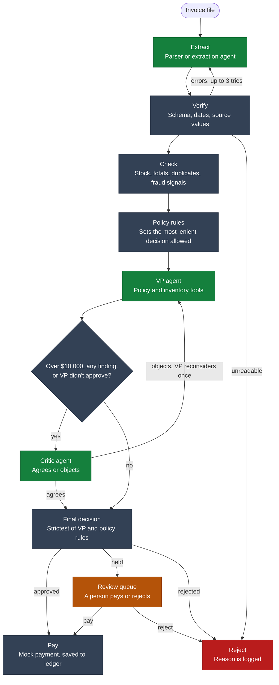

# AutoVoice

AutoVoice is a working multi-agent prototype that takes an invoice from a messy file to one of three results: paid, rejected or held for a person. Every step is recorded.

It was built for the Galatiq invoice processing case. Acme Corp is fictional, the sample invoices are test data, and no real money moves: payments go through a mock function.

## Why it matters

Acme loses an estimated $2M a year on manual invoice processing, with a 30% error rate and 5-day delays.

| Problem | What AutoVoice changes |
|---|---|
| Errors and overpayments | Repeatable checks cover stock, totals, duplicates and fraud signals, and the database blocks a second payment |
| 5-day delays | Clean invoices finish without a person, so staff only see the ones that need them |
| Approvals lost in email chains | Each decision has written reasoning and an audit trail |

These results come from 20 sample files, not production data. The share of the $2M this would recover would need to be measured in a pilot.

## Quick start

Tested on Python 3.12.

```bash
python -m venv .venv
source .venv/Scripts/activate      # Windows Git Bash (macOS/Linux: source .venv/bin/activate)
pip install -r requirements.txt

streamlit run app.py                                           # the app
python main.py --invoice_path=data/invoices/invoice_1001.txt   # one invoice
python main.py --batch=data/invoices --offline --reset         # all samples, no model
python -m pytest -q                                            # tests
```

**No API key is needed to try it.** Without a key, a built-in simulation stands in for the model, so everything runs offline. In the app, this is the Demo mode switch.

To use Grok, create a `.env` file containing `XAI_API_KEY=your_key`. To use another model, change the `MODEL` line in `config.py`.

The ledger is kept between runs, so processing a paid invoice again is rejected as a duplicate. Use `--reset` to start over.

## Project layout

```
app.py       Streamlit app
main.py      Command line
config.py    Model and settings
agents/      Extraction, VP and critic agents
workflow/    LangGraph workflow
services/    File reading, checks, payment and human review
database/    SQLite inventory and payment ledger
schemas/     Invoice and decision models
data/        Sample invoices
tests/       Tests for every stage
```

## How it works



| Stage | Who does it | What happens |
|---|---|---|
| **Read** | Parser for JSON, CSV and XML; model for TXT and PDF | Produces a checked invoice. A verifier catches schema errors, unreadable dates and values not found in the source, then sends them back for a retry. |
| **Check** | Code | Compares the invoice with the SQLite inventory, and checks totals, duplicates, currency and fraud signals. |
| **Approve** | VP and critic agents, within fixed rules | The VP uses tools to look up policy and inventory, then decides. High-value, risky or rejected invoices also go to a critic, who can send the decision back. The VP has the final say. |
| **Pay** | Code | Pays only after approval. Otherwise the invoice is rejected or held, with the reason logged. |

The workflow runs on LangGraph, including the retry and review loops.

### Key decisions

- **The model can be stricter than the rules, but never more lenient.** Code sets the most lenient decision allowed, so a wrong or manipulated reply can't release money.
- **There are three outcomes, not two.** Some invoices aren't wrong but do need a person. These go to a review queue, where someone can pay or reject them and must leave a note.
- **Failures are safe.** If the model fails during extraction, pattern matching takes over. If it fails during approval, the invoice is rejected.
- **Payments have a last line of defense.** A unique database index blocks a second payment even if every earlier check misses it.
- **A revision pays only the difference.** A corrected version of a paid invoice doesn't get paid in full again.
- **Invoice text is treated as data.** Text that tries to instruct the system causes a rejection.

## Results on the sample invoices

In Demo mode, running all 20 files in filename order pays 6, holds 4 and rejects 10, releasing $26,325. With a live model, the wording and some decisions may differ, but the rules still apply.

| Invoice | Result | Why |
|---|---|---|
| 1001, 1004, 1006, 1011 (PDF), 1015 | Paid | Clean |
| 1010 | Paid, with a warning | A WidgetA rush line is 20% above catalog price |
| 1002, 1005 | Rejected | GadgetX quantity exceeds stock |
| 1003 | Rejected | Zero-stock item, a due date of "yesterday", and pressure language |
| 1007 | Rejected | Exceeds stock, and the stated total is $110 too low |
| 1008, 1016 | Rejected | Items not in inventory |
| 1009 | Rejected | No vendor or due date, with a negative quantity and total |
| 1011 (TXT) | Rejected | The same invoice in another format, already paid |
| 1013 (JSON and PDF) | Rejected | Lines look fine alone but exceed stock when summed, and the total is $50 too high |
| 1004 revised | Held | Already paid at $1,890, so only the difference may be due |
| 1012 (TXT and PDF) | Held | The critic objects: a vendor rename plus a total just under $10,000 |
| 1014 | Held | In EUR, and the payment function has no currency field |

## Assumptions and limits

- Stock isn't reduced after payment. The brief expects INV-1001, 1004 and 1006 to all pass, which they might not if each one used up stock.
- Catalog prices are inferred from the sample invoices, and a missing currency is treated as USD.
- Scanned PDFs with no text layer can't be read, because OCR was cut from scope.
- Not all fraud is caught. There is no address or vendor check, which would need a real vendor list.
- Non-USD invoices can only be rejected in the review queue, because the payment function only pays USD.
